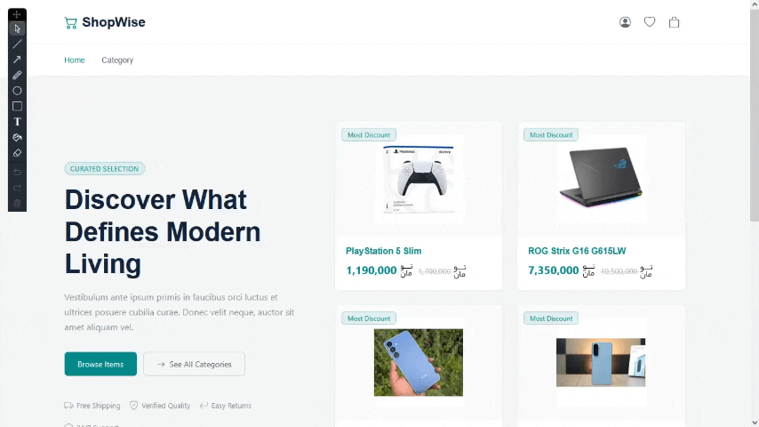
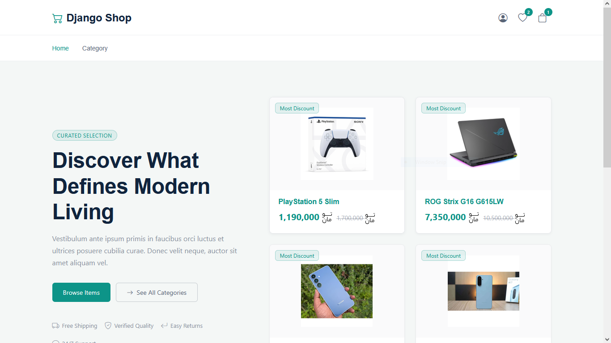
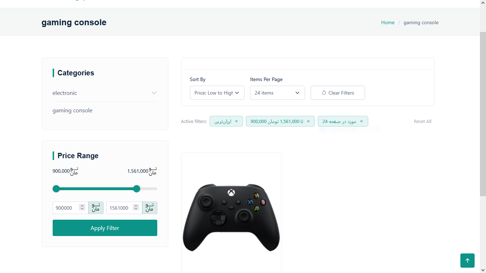
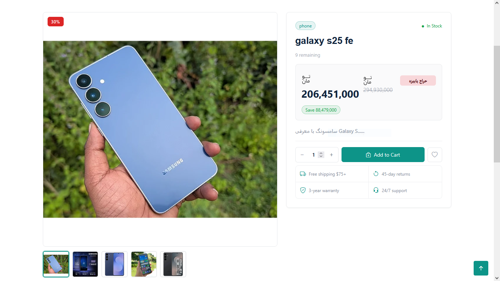
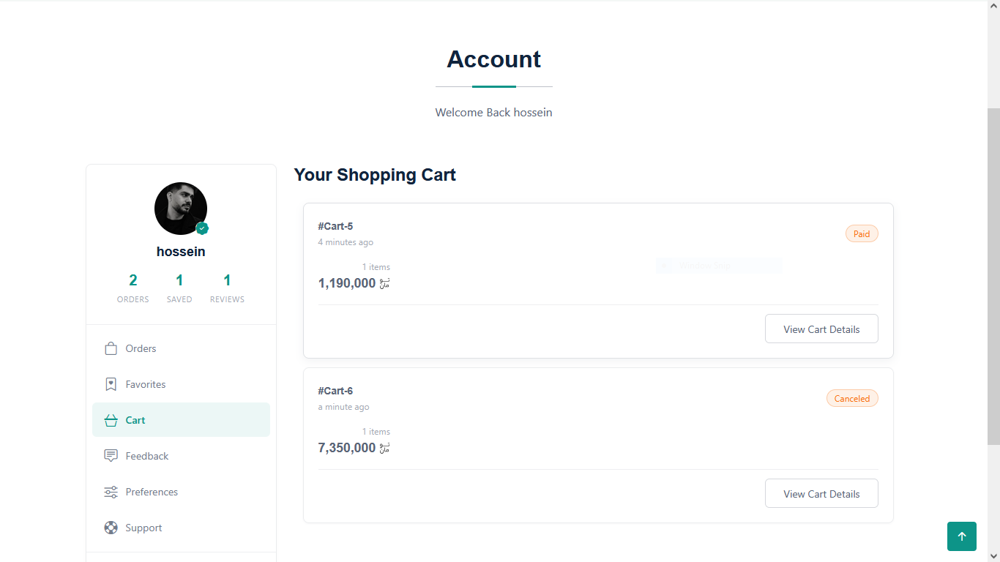
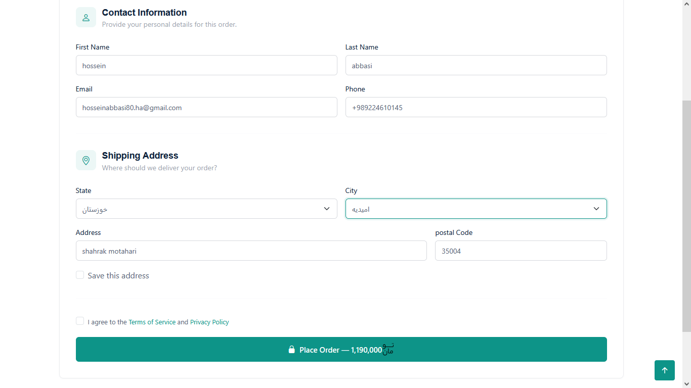
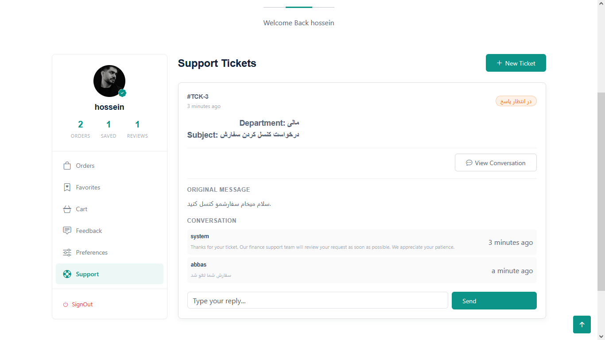
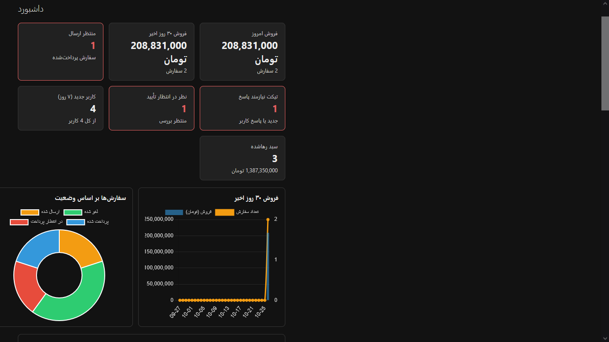
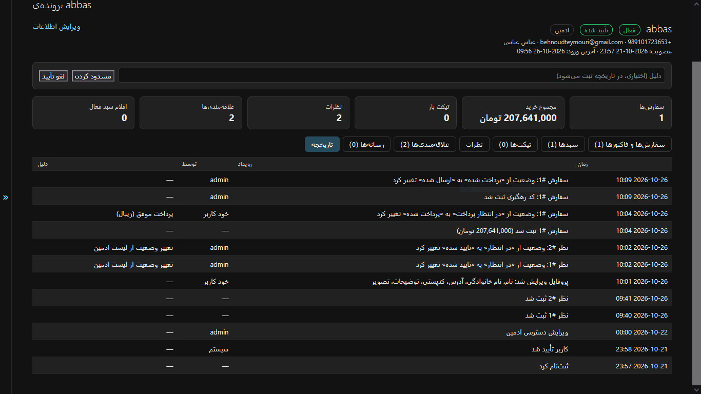
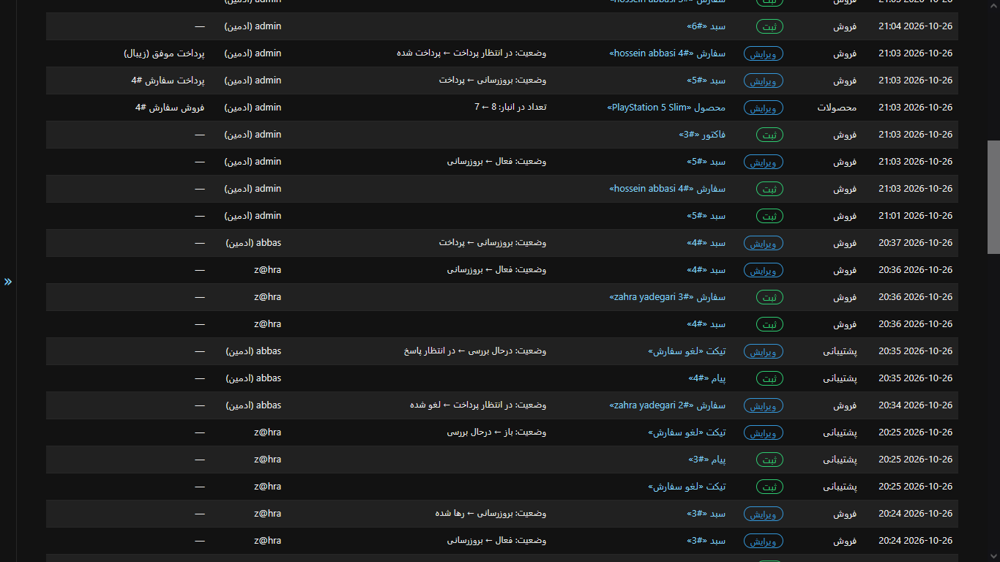

<div align="center">

# Django Shop

[English](README.md) · [فارسی](README.fa.md)


[](https://github.com/USER/REPO/actions/workflows/ci.yml)




</div>

<div dir="rtl">

## درباره‌ی پروژه

سلام من **حسین عباسی** هستم و این **Django Shop** است.

**Django Shop** یک پلتفرم فروشگاه آنلاین رایگان و متن باز است که تحت [مجوز MIT](LICENSE) در اختیار شما قرار گرفته است.
مستندات در پوشه [docs](docs) در دسترس هستند.
از وقتی که گذاشتید سپاسگذارم.

تلاش کردم هرآنچه میدانستم را با نهایت دقت و تلاش به طور کامل پیاده کنم و در این مسیر چیز های زیادی آموختم.
امیدوارم همانقدر که از توسعه این پروژه لذت بردم شماهم ازاستفاده ازش لذت ببرید.

## تصاویر

| ویترین فروشگاه | فیلترهای دسته‌بندی | صفحه‌ی محصول |
|---|---|---|
|  |  |  |

| سبد خرید | تسویه‌حساب و پرداخت | تیکت‌های پشتیبانی |
|---|---|---|
|  |  |  |

| داشبورد مدیریت | پرونده‌ی کاربر | گزارش فعالیت‌ها |
|---|---|---|
|  |  |  |

## نقاط قوت

- **یک مسیر کامل خرید:** مرور محصولات، فیلتر، علاقه‌مندی، افزودن به سبد، پرداخت آنلاین و پیگیری سفارش.
- **ساخته‌شده برای ایران:** رابط فارسی، قیمت به تومان، استان‌ها و شهرهای ایران، درگاه زیبال و ورود با شماره‌ی موبایل.
- **پشتیبانی از مشتری از همان ابتدا:** تیکت‌های پشتیبانی، نظرات مدیریت‌شده، تأیید هویت با ایمیل.
- **اجرای آسان:** راه‌اندازی با Docker و PostgreSQL.
- **مدیریت آسان:** داشبوردی که نشان می‌دهد امروز چه چیزی به توجه نیاز دارد و تاریخچه‌ی کامل هر تغییر.

## قابلیت‌ها

### حساب‌ها و پروفایل
- ورود با شماره‌ی موبایل، نام کاربری یا ایمیل؛ هر کدام که با آن راحت‌ترید
- ثبت‌نام با تأیید ایمیل و تأیید پیامکی
- تغییر و بازیابی رمز عبور با صفحه‌های اختصاصی
- پروفایل با آدرس، کدپستی و تصویر؛ فایل‌های آپلودی از نظر نوع و حجم بررسی می‌شوند و به WebP تبدیل می‌شوند
- میکسین‌های دسترسی قابل‌استفاده‌ی مجدد برای نیازهای مدیریت حساب‌ها

### کاتالوگ و مرور محصولات
- محصولات با چند تصویر، مشخصات انعطاف‌پذیر، موجودی انبار و وضعیت پیش‌نویس یا منتشرشده
- اسلاگ‌هایی که با عنوان فارسی هم کار می‌کنند
- دسته‌بندی‌های تودرتو و نامحدود، با آدرس‌های تمیز که مسیر دسته‌بندی را دنبال می‌کنند
- صفحه‌ی دسته‌بندی با فیلتر بازه‌ی قیمت، مرتب‌سازی (ارزان‌ترین، گران‌ترین، جدیدترین)، انتخاب تعداد در صفحه، برچسب‌های فیلتر قابل‌حذف و صفحه‌بندی فشرده
- کمپین‌های تخفیف: یک درصد را برای چند محصول تعیین کنید تا قیمت‌های تخفیف‌خورده خودکار محاسبه شوند؛ هر کمپین را هر زمان روشن یا خاموش کنید

### نظرات و علاقه‌مندی‌ها
- نظرات تودرتو همراه با پاسخ
- مدیریت نظرات: نظر جدید منتظر تأیید می‌ماند و فقط نظرات تأییدشده نمایش داده می‌شوند
- علاقه‌مندی‌هایی که مشتری می‌تواند اضافه و حذف کند

### سبد خرید، تسویه‌حساب و پرداخت
- سبد خریدی که موجودی را بررسی می‌کند و همیشه قیمت‌ها و تخفیف‌های فعلی را نشان می‌دهد
- تسویه‌حساب با انتخاب استان و شهر، آدرس از پیش پرشده از روی پروفایل، مرحله‌ی بازبینی و پذیرش قوانین
- پرداخت آنلاین از طریق [زیبال](https://zibal.ir) (آماده‌ی حالت آزمایشی): هر پرداخت سمت سرور تأیید می‌شود، بازگشت‌های تکراری از درگاه هرگز فاکتور تکراری نمی‌سازند و پرداخت ناموفق قابل تلاش دوباره است
- سفارش‌ها با وضعیت و کد رهگیری؛ ردیف‌های فاکتور قیمت لحظه‌ی خرید را نگه می‌دارند

### تیکت‌های پشتیبانی
- تیکت برای یک بخش (مالی، فنی، حساب کاربری و ...)
- گفتگوی پیوسته همراه با پاسخ خودکار اولیه
- وضعیت تیکت با پیشرفت گفتگو عوض می‌شود و تیکت‌های بسته‌شده بایگانی می‌شوند

### استوری و ویدیو
- ویدیوهای آپلودی بر اساس محتوای واقعی‌شان بررسی می‌شوند، نه فقط پسوند فایل
- کلیپ‌های ۱۵ ثانیه یا کوتاه‌تر خودکار استوری می‌شوند و استوری‌ها می‌توانند هایلایت شوند

### ابزارهای مدیریت فروشگاه
- **داشبورد:** کارت‌های فروش، نمودار فروش ۳۰ روز اخیر، سفارش‌های منتظر ارسال، تیکت‌های منتظر پاسخ و موجودی کم
- **پرونده‌ی کاربر:** سفارش‌های کاربر با ردیف‌های فاکتور، سبدها، تیکت‌ها، نظرات، علاقه‌مندی‌ها و رسانه‌ها در یک صفحه، با عملیات مسدود کردن، بازکردن حساب و تأیید همراه با ثبت دلیل
- **ردیابی تغییرات:** تاریخچه‌ی هر آیتم، فید فعالیت‌ها با مقدار قبل و بعد، و گزارش «وضعیت در تاریخ»
- **عملیات دسته‌جمعی** برای محصولات، نظرات، سفارش‌ها و تیکت‌ها، و منویی که بر اساس کارکرد دسته‌بندی شده است

### زیر کاپوت
- PostgreSQL و راه‌اندازی با Docker
- تاریخچه‌ی تغییرات مدل‌های کلیدی با `django-simple-history`
- سیگنال‌ها، managerهای اختصاصی و اعتبارسنج‌هایی که قوانین کسب‌وکار را در یک جا نگه می‌دارند
- docstring به سبک Google در کل کدبیس و مجموعه‌ی تست خودکار

## فناوری‌ها

| لایه | فناوری |
|---|---|
| بک‌اند | Python 3.11، Django 5.2 |
| پایگاه داده | PostgreSQL |
| فرانت‌اند | قالب‌های Django، قالب [Shopwise](https://bootstrapmade.com/shopwise-bootstrap-ecommerce-template/)، Swiper، GLightbox، Drift |
| نمودارهای مدیریت | Chart.js |
| پرداخت | درگاه زیبال |
| کتابخانه‌ها | django-simple-history، django-phonenumber-field، Pillow، python-magic، imageio-ffmpeg، requests |
| استقرار | Docker |

## راه‌اندازی سریع

### با Docker
</div>

<div dir="ltr">

```bash
git clone https://github.com/HSN80/Django-Shop.git
cd Django-Shop

cp .env.example .env             # then edit the values
docker compose up --build
docker compose exec backend python manage.py createsuperuser
```

</div>

### بدون Docker

<div dir="ltr">

```bash
python -m venv .venv
source .venv/bin/activate        # Windows: .venv\Scripts\activate
pip install -r requirements.txt

cp .env.example .env             # then edit the values
cd core
python manage.py migrate
python manage.py createsuperuser
python manage.py runserver
```

</div dir="rtl">

<div>
برای فروشگاه <http://127.0.0.1:8000/> و برای پنل مدیریت <http://127.0.0.1:8000/admin/> را باز کنید.

> بدون Docker، `python-magic` به کتابخانه‌ی سیستمی `libmagic` نیاز دارد (روی ویندوز `python-magic-bin` را نصب کنید).

### تنظیمات

| متغیر | کاربرد |
|---|---|
| `SECRET_KEY` | کلید مخفی Django |
| `DEBUG` | فقط در توسعه `True` باشد |
| `ALLOWED_HOSTS` | نام هاست‌ها، جداشده با ویرگول |
| `ZIBAL_MERCHANT` | کد پذیرنده‌ی زیبال؛ مقدار `zibal` حالت آزمایشی را فعال می‌کند |
| `SITE_ID` | شناسه ورودی سایت؛ دامنه آن را در بخش مدیریت تنظیم کنید |
| `EMAIL_HOST`, `EMAIL_PORT`, `EMAIL_USE_TLS` | سرور SMTP برای ایمیل‌های تأیید و بازنشانی |
| `EMAIL_HOST_USER`, `EMAIL_HOST_PASSWORD`, `DEFAULT_FROM_EMAIL` | حساب SMTP و نشانی فرستنده |

## تست‌شده
> یکپارچه‌سازی پیوسته

هر درخواست push و pull کل مجموعه را روی GitHub Actions (`.github/workflows/ci.yml`) اجرا می‌کند و بررسی می‌کند که آیا تصویر Docker ساخته شده است یا خیر. نشان موجود در README آخرین نتیجه را نشان می‌دهد.

خودتان اجرا کنید: `python manage.py test`

## مستندات

مستندات کامل در پوشه‌ی [`docs/`](docs/README.md) است (فعلاً به زبان انگلیسی):
[معماری](docs/architecture.md) ·
[مدل داده](docs/data-model.md) ·
[accounts](docs/apps/accounts.md) ·
[products](docs/apps/products.md) ·
[carts](docs/apps/carts.md) ·
[orders](docs/apps/orders.md) ·
[tickets](docs/apps/tickets.md) ·
[favorites](docs/apps/userfav.md) ·
[multimedia](docs/apps/multimedia.md) ·
[پرداخت](docs/payments.md) ·
[پنل مدیریت](docs/admin-panel.md) ·
[ردیابی تغییرات](docs/history-audit.md) ·
[تست‌ها](docs/testing.md) ·
[استقرار](docs/deployment.md)

## منابع و سپاس

- قالب فروشگاه: [Shopwise](https://bootstrapmade.com/shopwise-bootstrap-ecommerce-template/)،
- [Bootstrap](https://getbootstrap.com)، [Swiper](https://swiperjs.com)، [GLightbox](https://github.com/biati-digital/glightbox)، [Drift](https://github.com/imgix/drift)، [Chart.js](https://www.chartjs.org)
- پرداخت: [زیبال](https://zibal.ir)

## مجوز

MIT. فایل [LICENSE](LICENSE) را ببینید.

## نویسنده

**حسین عباسی** 

</div>