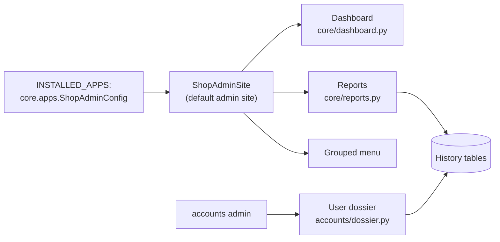
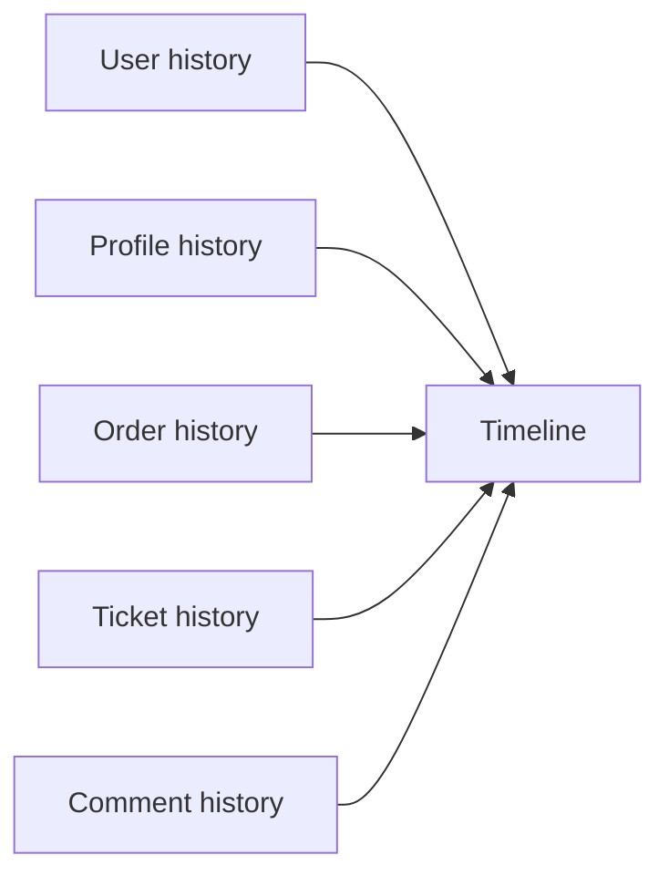

# Admin panel

The Django admin, extended into a back office: a dashboard on the first page, a per-user dossier, an activity feed, a "state at a date" report and a menu grouped by function. Creating and editing products, categories, discounts, orders and tickets happens here.

## What is in it

| Feature | Where to find it |
|---|---|
| [Dashboard](#dashboard) | The admin home page (superusers) |
| [Grouped menu](#menu) | The sidebar on every admin page |
| [User dossier](#user-dossier) | Users list, "View dossier" |
| [Activity feed](#activity-feed) | Reports, Activity |
| [State at a date](#state-at-a-date) | Reports, State at date |
| [Bulk actions](#bulk-actions) | The action drop-down of each list |
| Specifications editor | A product's page, [products](apps/products.md#specifications) |

## How it is wired

`ShopAdminConfig` replaces `django.contrib.admin` in `INSTALLED_APPS` and makes `core.admin_site.ShopAdminSite` the default site. The dashboard and the two reports are for superusers; other staff see the usual admin.

## Dashboard

Sales figures count only paid orders (`checkout`, `sent`, `arrived`), by the date the order was placed.

| Card | Meaning |
|---|---|
| Today's sales | Revenue and orders, with the change from yesterday |
| Last 30 days | Revenue and orders |
| Waiting to ship | Paid orders without shipping |
| Tickets needing a reply | Tickets in `open` or `progress` |
| Comments awaiting approval | `pending` comments |
| New users (7 days) | Out of all users, without the `system` user |
| Abandoned carts | How many and what they are worth |

Charts: sales for the last 30 days (revenue bars and an order-count line; days without sales show zero) and orders per status.
Tables: orders waiting to ship, the oldest tickets needing a reply, products low on stock (5 units or fewer), and the best sellers of the last 30 days.

Every card and "all" link opens the matching filtered list. The charts use Chart.js loaded from a CDN, so the dashboard needs internet access to draw them.

## Menu

The sidebar is grouped by what the owner does, not by app:

Users · Sales (orders, invoices, payments, carts) · Catalog (products, categories, discounts, images, comments) · Support · Engagement (favorites, media) · Reports · Other.

Models not listed in `SECTIONS` (`core/admin_site.py`) appear under "Other", so a new model is never hidden.

## User dossier

One page per user, opened from the users list or the user's page.

- **Header:** username, phone, email, name, join date, last login, and badges (active or banned, verified, staff).
- **Actions:** ban, unban, verify, unverify, with an optional reason (up to 60 characters). The reason, the admin's name and the time go into the history. Superusers and the logged-in admin cannot be banned.
- **Summary cards:** orders, total spent, open tickets, comments, favorites, items in the active cart.
- **Tabs:** orders with their invoice lines, carts, tickets, comments, favorites, media and a **history timeline**.

The timeline merges registration, bans and verification, profile edits, orders (with status changes and tracking codes), tickets and comments, newest first (up to 150 events). Saves that change nothing visible, such as a login updating `last_login`, are skipped.

## Activity feed

A timeline of changes across all 14 tracked models.

- **Filters:** section, action (created, changed, deleted), who (admins, customers, the system) and a date range.
- Each row shows the time, the section, the object (linked), **the changed fields with old and new values**, who did it and the reason.
- Shows 100 events and "show more" raises it to 500.
- Edits that changed no visible field are dropped, and deleted objects have no link.

## State at a date

Pick a section (products, categories, discounts, orders or users) and a day, and see how it looked at the end of that day, rebuilt from the history. Objects deleted by then are left out. If the chosen day is before history started, a notice says so.

## Bulk actions

| List | Actions |
|---|---|
| Users | Ban, unban, verify, unverify |
| Products | Publish, move to draft |
| Comments | Approve, reject |
| Orders | Mark as sent (paid orders with a tracking code), mark as arrived (sent orders) |
| Tickets | Close, reopen ("delete selected" is removed) |

Actions save objects one by one with a reason, so each change shows up in the history.

## Code map

| File | Role |
|---|---|
| `core/apps.py`, `core/admin_site.py` | The custom site, menu groups, report routes |
| `core/dashboard.py` | Dashboard data |
| `core/reports.py` | Activity feed and state-at-date data |
| `accounts/admin.py`, `accounts/dossier.py` | User admin and the dossier |
| `templates/admin/index.html` | The dashboard page |
| `templates/admin/activity.html`, `state_at.html` | The two reports |
| `templates/admin/accounts/user/dossier.html` | The dossier page |

## Good to know

- The `system` user (sender of automatic replies) is hidden from users, profiles and statistics.
- The activity feed makes one extra query for each edited row to find the previous version.
- A product's `discount` shown in lists is the price after the discount.