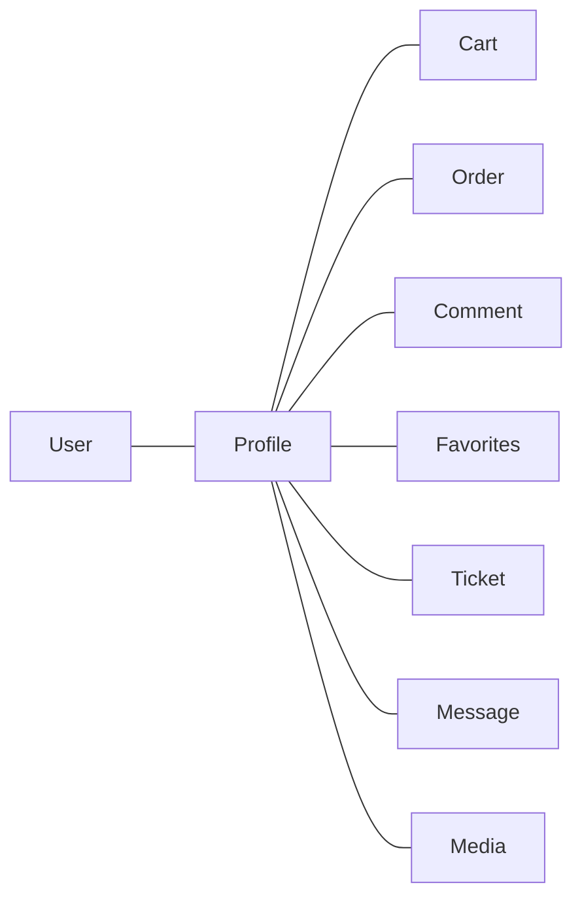
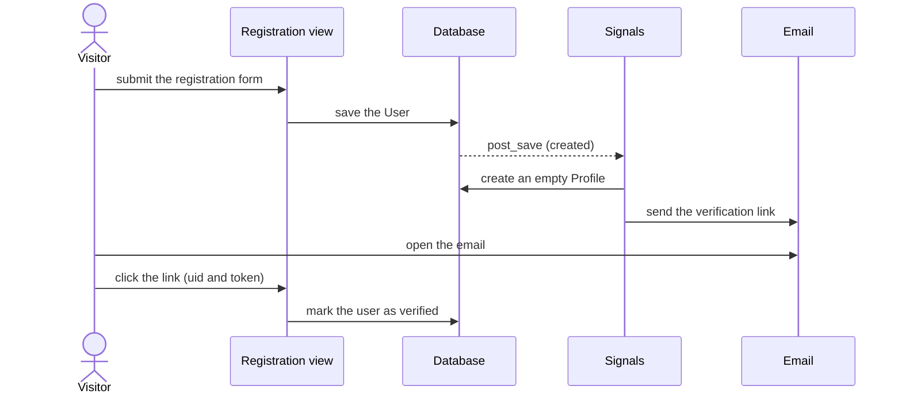

# accounts

The foundation of the project. It provides the custom user (who logs in with a phone number), the profile, verification, the password flows and the access rules that other apps reuse. Every other app depends on it, and it depends on nothing.

## What it provides

- Login with a phone number, a username or an email
- Registration with email verification
- Profiles with name, address, postal code and a picture
- Password change and password reset
- Access mixins for views (verified users only, staff users only, anonymous visitors only)
- Admin tools: order statistics per user, ban/unban and verify actions, and a full user dossier ([admin panel](../admin-panel.md))

## The profile is the hub

Almost everything a customer owns hangs off the `Profile`, not off the `User`.



The `User` holds identity and permissions; the `Profile` holds personal details and is the owner of carts, orders, comments, favorites, tickets, messages and media.

## Models

### User

A custom user built on `AbstractBaseUser` and `PermissionsMixin`.

| Field | Type | Notes |
|---|---|---|
| `phone` | `PhoneNumberField`, unique, max 13 | The login identifier (`USERNAME_FIELD`) |
| `username` | `CharField(24)`, unique | Display name; also accepted at login |
| `email` | `EmailField(64)` | unique; also accepted at login |
| `is_staff` | `BooleanField` | Can open the admin site |
| `is_active` | `BooleanField`, default `True` | `False` means banned |
| `is_verified` | `BooleanField`, default `False` | Set by email verification or by an admin |
| `is_superuser` | `BooleanField` | Has every permission |
| `created_date`, `updated_date` | `DateTimeField` | Maintained automatically |

It also inherits `password`, `last_login`, `groups` and `user_permissions`. History is recorded for every field except `password` and `last_login`, so password hashes are never copied and logins do not create history records.

Users are created through `UserManager`:

- `create_user(phone, password, **extra_fields)` requires a phone number and a password and hashes the password.
- `create_superuser(...)` sets `is_staff`, `is_active`, `is_verified` and `is_superuser` to `True`, so a superuser is verified from the start.

### Profile

| Field | Type | Notes |
|---|---|---|
| `user` | `OneToOneField(User)` | Reverse name `profile`; deleted with the user |
| `first_name`, `last_name` | `CharField(24)` | |
| `address` | `TextField` | Stored as `"<state>, <city>, <street>"` |
| `postal_code` | `CharField(12)` | |
| `image` | `ImageField` | Defaults to `image/default.svg`; see below |
| `description` | `TextField` | Free text |
| `created_date`, `updated_date` | `DateTimeField` | |

A profile is created automatically, with empty fields, for every new user.

**Profile pictures.** The `image_validator` accepts JPEG, PNG and WEBP files of at most 1 MB and checks that the file really is an image. When a new picture is uploaded, `Profile.save` converts it to WebP (quality 65) and renames it. Pictures with transparency keep it; the default picture and pictures already stored are left unchanged.

**Addresses.** `ProfileModelForm` asks for a state and a city next to the street, and `clean` joins them into one `address` string. The checkout in [orders](orders.md) splits the same string back into its three parts.

## Sign-up and verification



- The link is built by `VerificationManager`: the user's id, encoded in base64, plus a one-time token from Django's default token generator. The token stops working when the user's password or last login changes, and it expires after `PASSWORD_RESET_TIMEOUT` (three days by default).
- The domain comes from the current request, or from the `Site` entry when no request is available (as in the signal), so the `Site` domain must be set to the real domain in production.
- Delivery is handled by verification *backends* that share one interface, `send(user, link)`:

| Backend | Status |
|---|---|
| `EmailVerificationBackend` | Sends the link by email, greeting the user by first name or username |

- The last step of the diagram happens in the verification view `verify-email/<uidb64>/<token>/`.

## Authentication

`MultiUsernameFieldBackend` extends Django's `ModelBackend`. It looks for a user whose username, email or phone matches the text typed in the login form (case-insensitively) and then checks the password.

Because it builds on `ModelBackend`, an inactive user is refused. This is what makes banning work: a banned user cannot log in, and an existing session stops being valid.

## Password flows

The routes live in `password_urls.py` and the views in `password_views.py`. They are thin subclasses of Django's built-in auth views that only set templates and redirects.

| Route name | Purpose |
|---|---|
| `Login` | Log in; users who are already logged in are redirected away |
| `Logout` | Log out (POST only) and return to the login page |
| `Password_change` | Change the password (requires login); returns to the catalog with a message |
| `Password_reset` | Ask for an email address and send a reset link |
| `Password_reset_done` | "Email sent" page |
| `Password_reset_confirm` | Choose a new password from the link (`uidb64` and `token`) |
| `Password_reset_complete` | "Password reset" page |

Because `email` is unique, a reset request sends a link to the exact active account that uses that address.

## Access mixins

Defined in `mixins.py` for class-based views.

**`IsVerifiedMixin`** allows only logged-in users whose account is verified. Anonymous users are sent to the login page with an error message; unverified users are sent to root address.

**`AnonymousUserMixin`** keeps logged-in users out of pages such as login and registration. It redirects them to the `next` parameter, then to the `Referer`, then to `default_redirect_url` (`/`). A target is used only if it is on the same host and is not the current page, which prevents open redirects and loops.

**`StaffRequiredMixin`** allows only staff users to access risky address such as `/admin` page.

```python
from accounts.mixins import IsVerifiedMixin


class MyOrdersView(IsVerifiedMixin, ListView):
    ...
```

## Signals

| Signal | Effect |
|---|---|
| `Save_Profile` | Creates an empty `Profile` when a user is created |
| `SendEmailVerification` | Emails a verification link to a user who is created unverified |

Superusers created with `createsuperuser` are already verified, so they receive no email. The internal `system` user, created by the [tickets](tickets.md) app, is hidden from the admin lists and from the dashboard statistics.

## Admin

- **Users:** shows order count and total spent per user, filters (verified, active, staff, join date), search by username, phone, email and name, and bulk actions to ban, unban, verify and unverify. A link opens the user dossier.
- **Profiles:** search by user and name, with an order count.
- Bans and verifications are saved through `save()` with a reason, so they appear in the user's history.

See the [admin panel](../admin-panel.md) for the dossier page and the activity feed.

## Pages and templates

| Page | Route | Notes |
|---|---|---|
| Login, logout, password flows | see the table above | Templates in `templates/registration/` |
| Registration | `accounts:Login` `accounts:Logout` ... | Uses `CustomUserRegisterationForm` |
| Profile | `accounts:Profile` | profile preferences, carts, orders, tickets, ... |
| Verify email | `accounts:Verify_email` | `verify-email/<uidb64>/<token>/` |
| Delete account | `accounts:Delete` | Template `accounts/delete.html` |

## Configuration

- `AUTH_USER_MODEL = 'accounts.User'`
- `AUTHENTICATION_BACKENDS` includes `MultiUsernameFieldBackend`
- Email settings for the verification and reset emails, and the `Site` domain

## Tests

The suite covers logging in by phone, banning and unbanning (a banned user cannot authenticate again), verification flags, the user dossier and the history recorded for each action. See [testing](../testing.md).

## Creating an administrator

```bash
python manage.py createsuperuser
```

The command asks for the phone number, username, email and password.