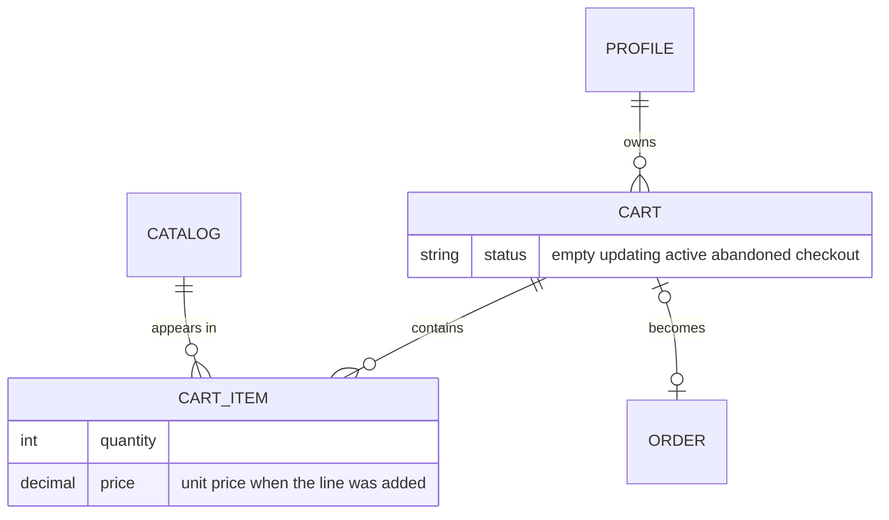
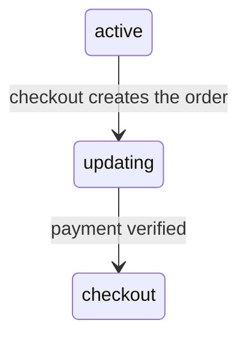

# carts

Shopping carts and the lines inside them. A cart belongs to a profile, checks stock every time a line is saved, and moves through a few statuses on its way from "being filled" to "paid".

## What it provides

- One active cart per customer, with product lines and quantities
- Stock validation on every line
- Totals at the products' current prices and discounts
- A hand-off to checkout: the cart is set aside while its order waits for payment
- Admin tools to inspect carts and lines, and a dashboard card for abandoned carts

## Models



### Cart

| Field | Notes |
|---|---|
| `profile` | The owner; carts are deleted with the profile |
| `status` | One of the five statuses below, `empty` by default |
| `created_date`, `updated_date` | Maintained automatically |

| Status | Meaning |
|---|---|
| `empty` | The default status of a new cart |
| `active` | The cart the customer is filling. A database constraint allows only one per profile |
| `updating` | Checkout has started; an order is waiting for payment |
| `checkout` | The order was paid |
| `abandoned` | A cart that was left behind |

- when every last item of a `active` cart where deleted, cart status changes to `empty`.
- if a user decides to cancel its cart, status changes to `abandoned`.
- every time a user try to checkout its cart, status changes to `updating`.

Useful members:

- `items_count`: the number of units in the cart (the sum of the quantities).
- `total_price`: the sum of `product.final_price × quantity`, so it follows the *current* price and discount of each product.

The `Cart` model keeps a change history. It uses a custom manager, `CartManager` (```CartManager``` checks if user already has a active cart,
otherwise create a new cart with active status.).

### CartItem

| Field | Notes |
|---|---|
| `cart` | The cart the line belongs to |
| `product` | The product; the line disappears if the product is deleted |
| `quantity` | Units wanted, `0` by default |
| `price` | The product's final price when the line was first saved (optional) |

**Stock rules.** `clean` refuses a quantity above the product's stock and refuses a product with zero stock. `save` first fills `price` from `product.final_price` if it is empty, then runs `full_clean`, so the stock check happens on every save and a line can never be stored with more units than the shop has.

`CartItem` has no history, because every "add to cart" would create a record.

## Cart and checkout



1. The checkout page looks for the customer's active cart. A missing or empty cart sends the customer back to the profile page with an error message.
2. When the order is created, the cart moves to `updating`. It is no longer "active", so it cannot be changed while the order waits for payment.
3. When the payment is verified, the cart moves to `checkout`, its lines become invoice lines and the stock is reduced ([orders](orders.md), [payments](../payments.md)).

## Pages and routes

- `create/` : creating new cart object or if there is any active one, checks for its item, if select items already exists in
cart, updating its quantity and if its not exists, add
them in. using `AddToCartView` in cart views.
- `<pk>/delete/` : deleting items from a active cart. using `DeleteFromCartView` in cart views.
- `cancel/<pk>/` : cancels the given cart. using `CancelCartView`.
- Template tags in `templatetags/cart_tags.py`: `get_active_cart(user)` a helper function to get active cart from user`s request.

## Admin

- **Carts:** item count and total per cart, filters by status and date, search by username and phone, and a read-only list of the cart's lines inside the cart page.
- **Cart items:** a plain list of lines.
- The admin totals use the price stored on each line (or the product price when a line has none).
- The user dossier lists each user's carts, and the dashboard shows how many carts are abandoned and what they are worth ([admin panel](../admin-panel.md)).

## Good to know

- Two totals exist. `Cart.total_price` uses current prices and is what the order is charged; `CartItem.price` remembers the price when the item was added and is what the admin shows. They differ only if a price changes after the item was added.
- Because validation runs on every save, an existing line cannot be saved again once the stock has dropped below its quantity.

## Tests

The suite checks the cart totals in the admin and the abandoned-carts card on the dashboard, and the payment tests build carts to check that a paid cart ends in `checkout`. See [testing](../testing.md).