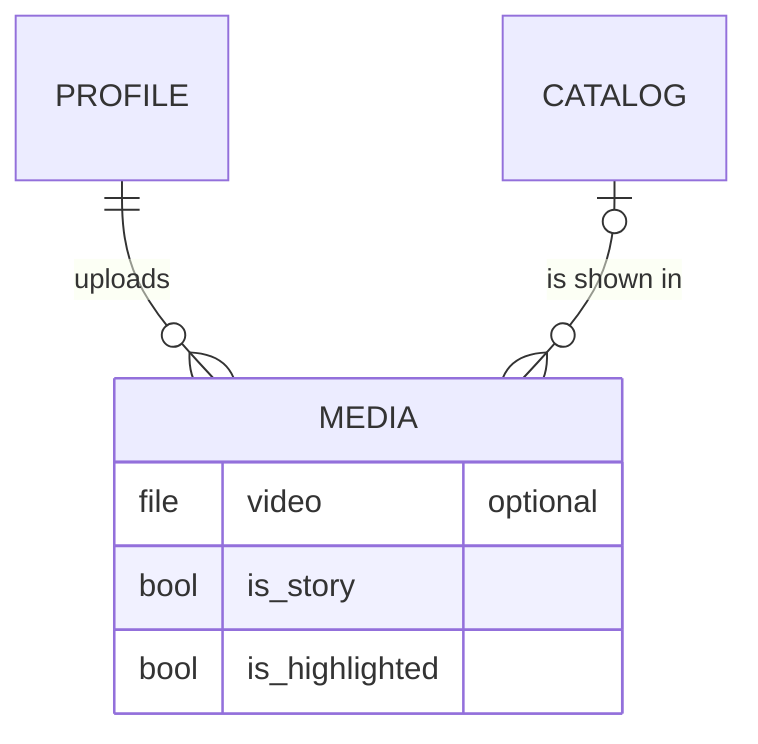
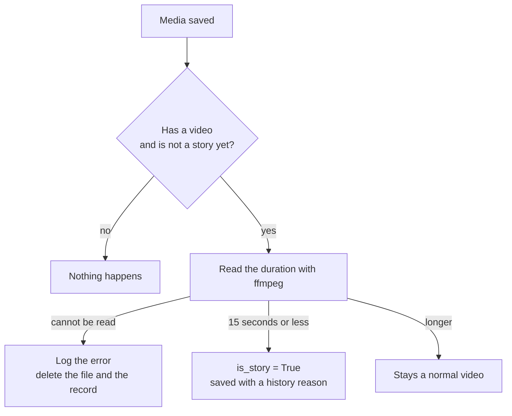

# multimedia

Short videos for the shop: customers or staff upload a clip, and clips of 15 seconds or less automatically become stories that can then be highlighted.

## What it provides

- Video uploads checked by their real content, not just the file name
- Automatic stories for short clips
- Highlights, which are limited to stories
- Admin filters and a history of every change

## Model

| Field | Notes |
|---|---|
| `profile` | The uploader; media is deleted with the profile |
| `product` | The related product (optional); media is deleted with the product |
| `video` | The file (optional), stored under `media/videos/` |
| `is_story` | Set automatically for clips of 15 seconds or less |
| `is_highlighted` | Only stories can be highlighted |

`Media` keeps a change history.

## Upload checks

A video must pass two validators:

- the file extension must be one of `mp4`, `avi`, `mov`, `webm` or `mkv`;
- `content_type_validator` reads the first 1024 bytes and detects the real type with `python-magic`, accepting MP4, AVI, MOV, WEBM and MKV. A renamed image or document is refused.

`python-magic` needs the `libmagic` system library (the Docker image includes it).

## Automatic stories

The work is done by the `trigger_story` signal after every save. Duration is read with `imageio-ffmpeg`, which ships its own ffmpeg binary.

## Highlights

A highlight must be a story. The rule is enforced twice: `Media.clean` shows a form error in the admin, and a database constraint (`story_required_for_highlight`) protects every other code path. Because stories are set after the upload is saved, a brand-new upload cannot be highlighted straight away.

## Pages and routes

Videos are uploaded and managed in the admin; the project has no storefront page for uploading them.

## Admin

A list with the uploader, product, story and highlight flags, filters by those flags and by date, and search by username and product title. The user dossier has a tab for each user's media.

## Good to know

- Any error while reading a video is treated as "not a video": the error is logged, and the file and record are deleted. Check the logs after deploying, and make sure the ffmpeg binary runs on the server, otherwise every upload would be removed.
- A media that is not a story is read again by ffmpeg on every save, even when only a flag changes.

## Tests

The suite covers a media without a video, a short video becoming a story (with a history record), a long video staying normal, and an unreadable video being removed together with its file. These tests replace ffmpeg with a fake reader, so they run without a video file. See [testing](../testing.md).