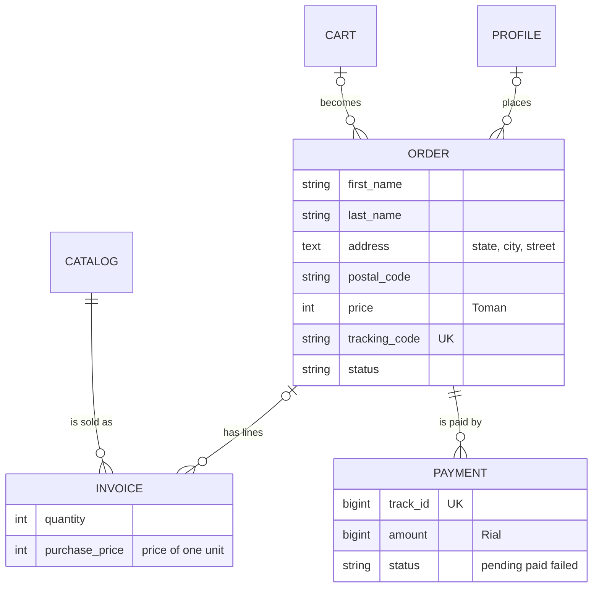
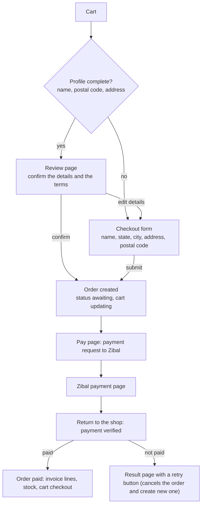

# orders

Everything between "I want to buy this" and "it is on its way": the checkout, the order, the invoice lines and the payment. The payment itself is covered in [payments](../payments.md); this page explains the rest.

## What it provides

- A checkout form with Iranian province and city selection and a review step
- Orders with statuses and tracking codes
- Invoice lines that keep the price at the time of purchase
- Online payment through Zibal, one `Payment` record per attempt
- Admin tools to ship orders, search them and follow their history

## Models

### Order

| Field | Notes |
|---|---|
| `profile` | The buyer. Becomes empty if the profile is deleted, so the order is kept |
| `cart` | The cart the order came from (many-to-one). Becomes empty if the cart is deleted |
| `first_name`, `last_name`, `address`, `postal_code` | The recipient, copied into the order so later profile edits do not change it |
| `price` | The total in Toman, taken from the cart at checkout |
| `tracking_code` | Unique shipping code, empty until the order is sent |
| `status` | See below; `awaiting` by default |

| Status | Meaning |
|---|---|
| `awaiting` | Waiting for payment |
| `checkout` | Paid, waiting to be shipped |
| `sent` | Shipped (needs a tracking code) |
| `arrived` | Delivered |
| `canceled` | Canceled by user |

`Order.PAID_STATUSES` (`checkout`, `sent`, `arrived`) lists the statuses that count as a sale. The dashboard, the user statistics and the reports all use it. The lifecycle diagram is in the [data model](../data-model.md).

### Invoice

One product line of an order: the product, the `quantity` and the `purchase_price`, which is the price of **one unit** when the order was paid. A product that appears on an invoice can no longer be deleted.

### Payment

One attempt to pay an order at the gateway: the gateway's `track_id`, the `amount` in Rials, the `status` (`pending`, `paid`, `failed`), the reference number, the masked card and the payment time. An order can have several payments, for example after a failed attempt. See [payments](../payments.md).

`Order` and `Invoice` keep a change history.

## The checkout flow

### The checkout form (`OrderView`)

A `CreateView` that requires login and a non-empty active cart. A missing or empty cart redirects to the wallet tab of the profile page with an error message.

- On a fresh page the form is pre-filled from the profile: the saved address `"<state>, <city>, <street>"` is split by `parse_address`. If it cannot be split, the whole text becomes the street.
- After a failed submission the values the customer typed are shown again.
- On a valid form the order is linked to the buyer's profile and cart, its price is set from the cart total, and the order is saved once. The cart moves to `updating` in the same transaction, so a failed save leaves the cart untouched.
- The customer is then redirected to the payment step of the new order.

### The review page (`OrderReview`)

Shows the cart together with the buyer's name, postal code and the address split into state, city and street. It requires login and a non-empty cart. If the profile lacks a name, a postal code or a parsable address, the customer is sent to the checkout form instead.

### The form (`OrderModelForm`)

| Field | Required | Purpose |
|---|---|---|
| `first_name`, `last_name`, `postal_code`, `address` | Yes | Order fields |
| `state_select`, `city_select` | Yes | Merged into `address` as `"<state>, <city>, <street>"` |
| `terms` | Yes | The customer accepts the terms |
| `confirm_info` | Only on the review step | The customer confirms the details are correct |
| `is_review_submission` | Hidden | Marks a submission that comes from the review page |

### Province and city selection

The select boxes are filled from `staticfiles/assets/js/iran-provinces-and-cities.json` by `province-select.js`, and the checkout page restores the previous choice.

## Routes

All routes belong to the `orders` namespace.

| Route name | Path | View | Purpose |
|---|---|---|---|
| `checkout` | `` | `OrderView` | The checkout form; creates the order |
| `review` | `review/` | `OrderReview` | Review before ordering |
| `pay` | `<pk>/pay/` | `PaymentStartView` | Starts the payment of an unpaid order |
| `verify` | `verify/` | `PaymentVerifyView` | The page Zibal sends the customer back to |
| `result` | `payment/<pk>/` | `PaymentResultView` | The outcome of a payment |

## Admin

- **Orders:** the list shows the recipient, buyer, price, status and tracking code. It has filters (status, date), a date drill-down, and search by tracking code, name, postal code, phone and username. The buyer, cart, price and timestamps are read-only, so financial data cannot be edited. Invoice lines appear read-only inside the order.
- **Bulk actions:** "mark as sent" changes only paid orders (`checkout`) that already have a tracking code, and "mark as arrived" changes only sent orders. Skipped orders are counted in the message. Each change is saved with a reason and appears in the history.
- **Invoices:** a list with search by product and tracking code.
- **Payments:** a read-only list with the amount in Toman, status, reference number and time.

The dashboard's "waiting to ship" card counts orders in `checkout` status, and the user dossier lists each user's orders with their invoice lines ([admin panel](../admin-panel.md)).

## Templates

| File | Used for |
|---|---|
| `templates/orders/checkout.html` | The checkout form |
| `templates/orders/review.html` | The review page |
| `templates/orders/payment_result.html` | The payment result |

## Good to know

- Prices are in Toman everywhere; only the payment request converts them to Rials (×10).
- Stock is reduced when a payment is verified, not when the order is created.
- An order that is never paid changes to `canceled` and its cart changes back to `active`.

## Tests

The suite covers checkout (the order is linked to the profile and cart, then the customer goes to payment), the whole payment flow, the "mark as sent / arrived" actions and the order search. See [testing](../testing.md).