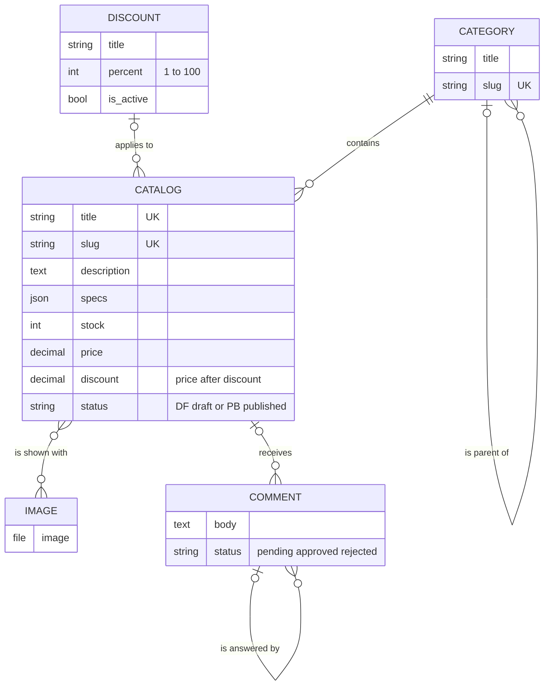
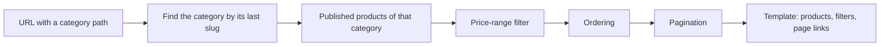
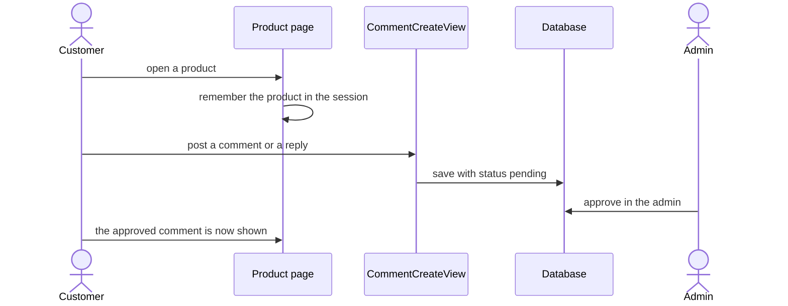
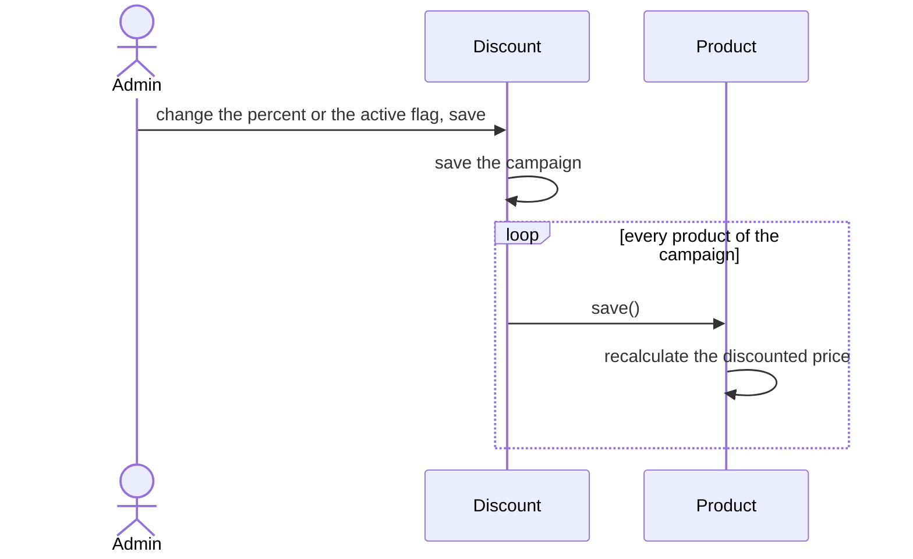

# products

The heart of the shop window: the product catalog, the category tree, discount campaigns, moderated comments and product pictures. It also serves the three public pages customers see most: the home page, the category page and the product page.

## What it provides

- Products with several pictures, flexible specifications, stock and a draft or published status
- Unlimited nested categories with clean URLs
- Category pages with a price-range filter, sorting, page-size selection and compact pagination
- Discount campaigns that apply one percentage to many products
- Threaded comments that are moderated before they appear
- A product management area in the admin (stock indicators, bulk publish, a friendly specifications editor)

`(Creating, editing and deleting products, categories and discounts is done in the admin. The views for site itself has been deleted since it works the best in admin panel.)`

## Models



### Catalog

| Field | Notes |
|---|---|
| `title` | Unique name |
| `slug` | Unique( uses `random_suffix` to make sure stays that way); Unicode (Persian) letters are allowed |
| `description`, `specs` | Long text and the specifications (see below) |
| `images` | Many-to-many with `Image` |
| `stock` | Units in stock, `1` by default |
| `price` | Regular price in Toman |
| `discount` | The price *after* the discount, or empty when no discount applies. It is calculated, never typed |
| `discount_campaign` | The campaign applied to this product (optional) |
| `category` | Required; a category that still has products cannot be deleted |
| `status` | `DF` (draft, the default) or `PB` (published) |

Useful members:

- `final_price`: the price a customer pays, either `discount` or `price`.
- `snippet()`: the first 25 characters of the description.
- `get_absolute_url()`: the product page URL, built from the category path and the slug.
- `save()`: recalculates `discount` every time the product is saved.

**Two managers.** `Catalog.objects` returns every product, drafts included (the admin uses it). `Catalog.published` returns only published products, and every public page uses it, so a draft is never visible to customers.

### Category

A node in a tree: `parent` points to another category, or is empty for a top-level one.

- The slug is generated from the title on every save.
- `get_category_path()` returns the slugs from the top-level ancestor down, for example `electronics/phones/android`.
- Deleting a category deletes its children; deleting one that still has products is refused.

### Discount

| Field | Notes |
|---|---|
| `title` | Campaign name |
| `percent` | 1 to 100 |
| `is_active` | An inactive campaign gives no discount |

### Comment

| Field | Notes |
|---|---|
| `user` | The author's `Profile` |
| `product` | The commented product |
| `parent` | The comment this one answers; empty for a top-level comment (reverse name `replies`) |
| `body` | The text |
| `status` | `pending` (default), `approved` or `rejected` |

`is_reply` tells whether a comment answers another one. Only approved comments are shown on the product page.

### Image

A picture stored under `products/` in the media folder. One image can be shared by several products.

All five models keep a change history ([audit trail](../history-audit.md)).

## Specifications

Specifications are grouped, and the product page prints one table per group. They are stored as:

```json
{
  "Dimensions": {"Length": "12 cm", "Width": "5 cm"},
  "Weight": {"Net": "1 kg"}
}
```

In the admin this is edited with a visual editor instead of raw JSON:

- Add and remove groups and rows with buttons, with no JSON to type.
- Group titles and names are suggested from the 200 most recent products, so similar products use the same words.
- Pressing Enter moves to the next field instead of submitting the form.
- Empty rows and groups are dropped. A name without a value (or the reverse), a repeated name or a repeated group is rejected with a clear message.
- Limits: 30 groups, 60 rows per group, titles and names up to 80 characters, values up to 300.
- Older data that is not grouped (`{"color": "red"}`) opens in a group called "General specs" and is saved in the grouped shape.

The code lives in `products/specs.py`.

## Pages and routes

All routes belong to the `products` namespace.

| Route name | Path | View | What it shows |
|---|---|---|---|
| `Catalog_list` | `` | `CatalogListView` | The home page: published products |
| `Catalog_detail` | `products/<category_path>/<slug>/` | `CatalogDetailView` | One product |
| `Category_list` | `categorys/` and `categorys/<category_path>/` | `CategoryListView` | A category page |
| `Comment_create` | `comments/create/` | `CommentCreateView` | Post a comment or reply |
| `Comment_delete` | `comments/<pk>/delete/` | `CommentDelete` | Delete a comment |

### Home page

`CatalogListView` lists published products, loading their categories in the same query.

### Category page



The page understands these query parameters. Invalid values are ignored and replaced by the defaults.

| Parameter | Values | Default |
|---|---|---|
| `ordering_by` | `low_to_high`, `high_to_low`, `newest` | Newest first |
| `min_price`, `max_price` | Numbers, kept inside the cheapest and most expensive product of the category and swapped if reversed | The full range |
| `per_page` | 12, 24, 48 or 96 | 12 |
| `page` | Page number | 1 |

Besides the products, the template receives the top-level categories with their children, the selected category, the price bounds, the current query string (without `page`, for building page links), a list of active filters (each with a link that removes it) and a compact page range with ellipses.

Good to know: the page lists only the products placed directly in the selected category, not those of its subcategories, and a URL without a category path shows an empty list.

### Product page

`CatalogDetailView` finds a published product by its slug (a draft gives 404) and loads, in a few queries, its category, its discount campaign and its approved comments with their approved replies. It also adds `save_price` (the amount saved) when there is a discount.

The view stores the product's id in the session. The comment form relies on it to know which product is being commented.

### Comments



- Posting requires login. The comment is saved for the user's profile and the product stored in the session, and the customer returns to the product page.
- A reply carries its `parent`, which must belong to the same product.
- Customers can delete only their own comments, and staff can delete any. The delete route accepts POST only.

## Discounts



A product's discounted price is `price - price × percent / 100` when its campaign is active, and empty otherwise. Because every save recalculates it, a value typed into the `discount` field is always overwritten.

## Admin

- **Products:** thumbnail, price, discount, a coloured stock label ("out of stock", "low stock"), filters (status, stock level, category, campaign), search (title, slug, category), inline editing of status, stock and price, bulk actions to publish or move to draft, and the specifications editor. Low stock means 5 units or fewer.
- **Categories:** product count per category; the slug fills in from the title.
- **Discounts:** product count per campaign and an on/off switch in the list.
- **Comments:** filters by status and date, search by text, author and product, and bulk approve and reject.
- **Images:** a thumbnail preview.

Every bulk action saves objects one by one with a reason, so each change appears in the history. See the [admin panel](../admin-panel.md).

## Signals

| Signal | Effect |
|---|---|
| `catalog_prepopulated_slug` | Fills a missing slug from the title plus a short random suffix |
| `category_prepopulated_slug` | Fills a missing slug from the title (the category's `save()` already does this) |

## Templates and scripts

| File | Used for |
|---|---|
| `templates/index.html` | Home page |
| `templates/products/category/category.html` | Category page |
| `templates/products/catalog/product-details.html` | Product page |
| `staticfiles/assets/js/price-widget.js` | The price-range control on category pages |
| `staticfiles/assets/js/reply-toggle.js` | Opens the reply form under a comment |

Template tags in `templatetags/product_tags.py`: 
- headers_context: retrive context for `profile`, `cart`, `order` and `favorites` for loged-in users.

## Good to know

- Renaming a category changes its slug, and so the URL of every product inside it. Two categories cannot share a title.
- Deleting a discount campaign unlinks its products but does not recalculate their stored discounted price; saving the product again fixes it.
- Saving a campaign re-saves each of its products one by one, which is slow for very large campaigns.

## Tests

The suite covers category paths (root, child, grandchild), the admin lists and the search that used to crash, bulk publish and comment approval, the specifications editor and its validation, and the product state reports. See [testing](../testing.md).