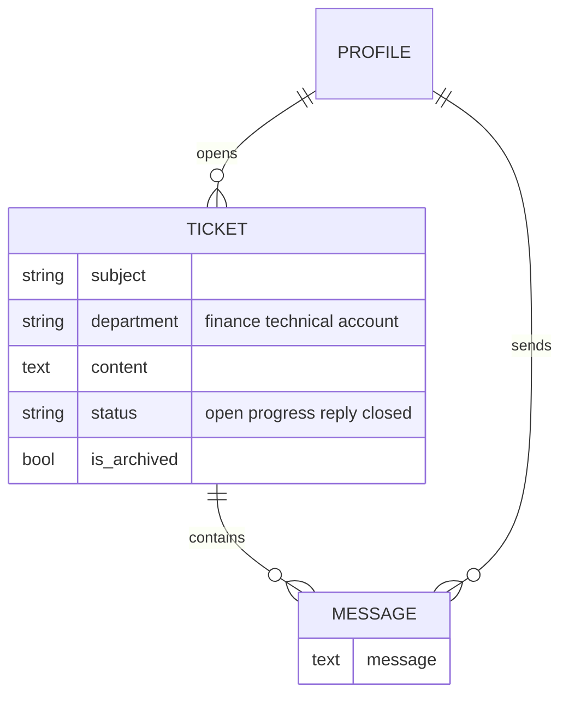
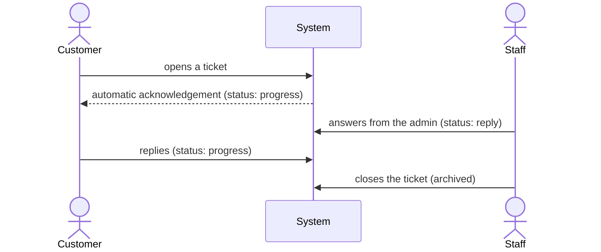

# tickets

A small helpdesk inside the shop: customers open a ticket for a department, staff answer from the admin, and the conversation keeps its status up to date by itself.

## What it provides

- Tickets sent to a department (finance, technical, account)
- A conversation thread with customer and staff messages
- An automatic acknowledgement for every new ticket
- A status that follows the conversation
- Closed tickets are archived, never deleted
- A dashboard card for tickets that need an answer

## Models

### Ticket

| Field | Notes |
|---|---|
| `profile` | The customer who opened it |
| `subject` | Up to 24 characters |
| `department` | `finance`, `technical` or `account` |
| `content` | The description of the problem (limited to 255 characters in the form) |
| `status` | `open`, `progress`, `reply` or `closed` |
| `is_archived` | Set automatically when the ticket is closed |

| Status | Meaning |
|---|---|
| `open` | Just created |
| `progress` | Waiting for staff (under review) |
| `reply` | Staff have answered; waiting for the customer |
| `closed` | Finished |

- `Ticket.save` sets `is_archived` whenever the status is `closed`. Reopening a ticket does not clear the flag by itself; the admin's reopen action does.
- `Ticket.delete` does not delete: it closes and archives the ticket, so a conversation is never lost by accident.
- `Ticket.objects` is `TicketArchiveManager` and hides archived tickets. Code that needs them must use `Ticket._base_manager`, as the admin and the user dossier do.

### Message

One message in a ticket: the `ticket`, the `sender` (the customer's or a staff member's profile) and the text. Messages are deleted with their ticket.

Both models keep a change history.

## The conversation

Two signals drive this:

- `ticket_system_response`: when a ticket is created, a message from the internal `system` profile is added.
- `ticket_status_changer`: whenever a message is saved, the ticket status becomes `reply` if the sender is staff and `progress` otherwise. The automatic acknowledgement comes from a non-staff profile, so a new ticket moves from `open` to `progress` immediately.

The `system` profile belongs to an inactive user named `system`, created on first use. It is hidden from the admin lists and from the dashboard statistics.

## Pages

The support tab of the profile page hosts the interface.

| Route name | Path | View | Purpose |
|---|---|---|---|
| `Ticket_create` | `create/` | `TicketCreateView` | Open a ticket (POST only, requires login) |
| `Message_create` | `create/<ticket_id>/reply/` | `MessageCreateView` | Reply to one of your own tickets |

- Both views redirect back to the support tab and report validation errors as messages.
- A customer can reply only to their own tickets, and a reply to a closed ticket is refused with a message.

### Forms

- `TicketCreateForm`: subject, department and content, with browser-side length limits (24 and 255 characters).
- `MessageCreateForm`: the message text only.

## Admin

- **Tickets:** filters by status, department, archived flag and date; search by subject, content, username and phone; a message count per ticket; and the conversation inline. A new staff reply is pre-filled with the current staff member's profile. Archived tickets are listed too.
- **Bulk actions:** close and reopen. "Delete selected" is removed on purpose, because a bulk delete bypasses the archive and would erase the tickets for good.
- **Messages:** a read-only list; replies are written from the ticket page.
- The dashboard card "tickets needing a reply" counts `open` and `progress`, and the dossier lists each user's tickets ([admin panel](../admin-panel.md)).

## Good to know

- A staff reply from the admin on an already closed ticket changes its status, but the ticket stays archived. Reopen it first.
- `Ticket.__str__` and `Message.__str__` read the profile's user, so lists that show them need `select_related`, which the admin does.

## Tests

The suite checks that closed tickets stay visible in the admin, that bulk delete is disabled, the close and reopen actions, the dashboard card and the hidden `system` user. See [testing](../testing.md).