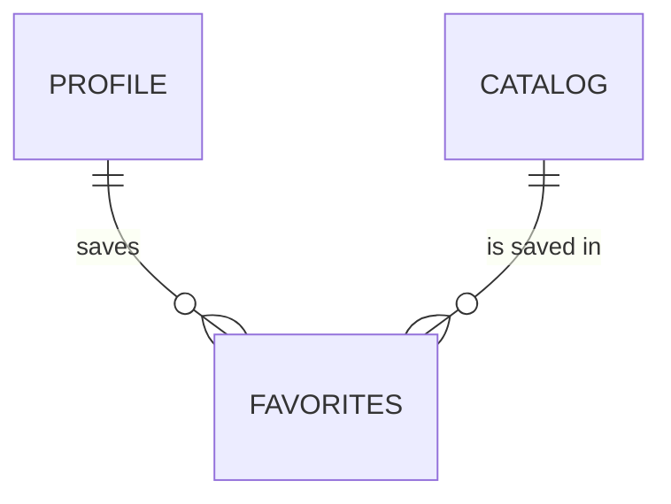

# userfav

Favorites: a customer saves a product to find it again later.

## What it provides

- Add and remove a product from the favorites
- Each customer sees only their own favorites
- Admin search and history

## Model

| Field | Notes |
|---|---|
| `profile` | The customer; favorites are deleted with the profile |
| `product_id` | The saved product. It is a foreign key to `Catalog` despite its name, so the database column is `product_id_id` |
| `created_date`, `updated_date` | Maintained automatically |

Favorites are listed oldest first and keep a change history, so the activity feed shows when a product was saved or removed.

## Views

| View | Purpose |
|---|---|
| `FavoriteCreate` | Receives the product id (validated by `AddtoFavorites`) and adds it |
| `FavoriteDelete` | Removes one favorite |
| `FavoriteList` | Lists the current user's favorites |

- All three require login and work only on the current user's own favorites; any other id returns 404.
- `FavoriteCreate` accepts POST only, uses `get_or_create` (saving the same product twice never makes a duplicate), shows a message when a favorite is added and returns to the page the customer came from.
- `FavoriteDelete` redirects back to the page the customer came from.

## Routes

| Route name | Path | View | Purpose |
|---|---|---|---|
| `Userfav_create` | `create/` | `FavoriteCreate` | saves a product for user |
| `Userfav_delete` | `<pk>/delete/` | `FavoriteDelete` | Delete one of the current user's favorites. Only favorites owned by the current user can be deleted; any other id returns 404 |

## Admin

A list with search by username and product title and a date filter. The user and the product are loaded together with the list.

## Good to know

- The database does not stop the same product from being saved twice by one user. The view prevents it; a unique constraint on `(profile, product_id)` would make it permanent.
- The field name `product_id` is a small naming debt: renaming it to `product` is cleaner, but admin, views and templates refer to the current name.

## Tests

The suite loads the favorites admin pages. See [testing](../testing.md).