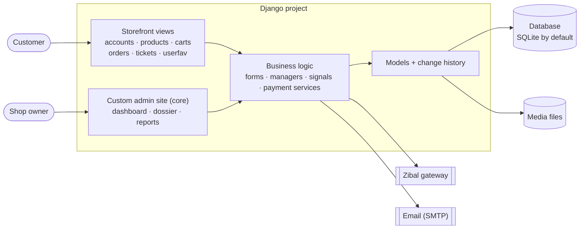
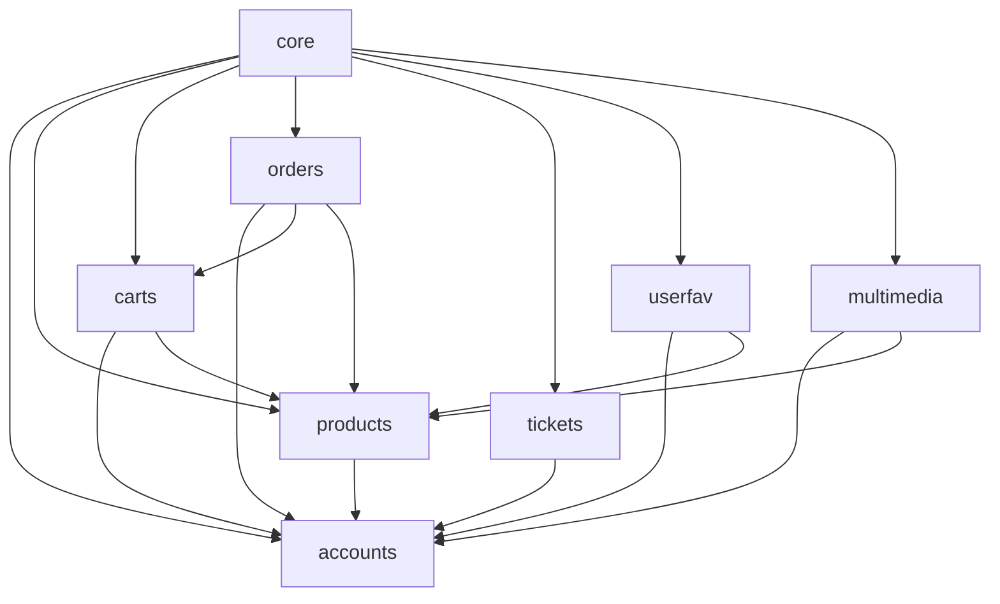
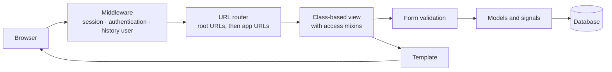

# Architecture

Django Shop is one Django project made of seven focused apps and a `core` package. Each app owns one part of the shop and keeps its models, views, forms and admin together.

## The big picture



## Apps and responsibilities

| App | Responsibility | Main models |
|---|---|---|
| `accounts` | Custom user that logs in with a phone number, profiles, email verification, password flows, access mixins | `User`, `Profile` |
| `products` | Catalog, nested categories, discount campaigns, moderated comments, images; the home, category and product pages | `Catalog`, `Category`, `Discount`, `Comment`, `Image` |
| `carts` | Shopping carts and their items, with stock validation | `Cart`, `CartItem` |
| `orders` | Checkout, orders, invoice lines, online payments | `Order`, `Invoice`, `Payment` |
| `tickets` | Support tickets with departments and a conversation thread | `Ticket`, `Message` |
| `userfav` | Favorite products | `Favorites` |
| `multimedia` | Video uploads, automatic stories and highlights | `Media` |
| `core` | Settings, root URLs, the custom admin site, the dashboard and the reports | none |

## How the apps depend on each other



`accounts` depends on nothing, so it is the foundation. `core` sits on top and reads from every app to build the dashboard and the reports.

## The life of a request



1. Middleware attaches the session and the user. The history middleware remembers who is acting, so every saved change can be attributed.
2. The URL router sends the request to a class-based view. Access rules live in mixins (for example, only verified users, or only anonymous visitors).
3. Forms validate input. Models enforce the rest: validators, constraints and `save()` rules.
4. Signals react to saved objects (create a profile, send a verification email, answer a new ticket).
5. A template renders the response.

Payments follow a different path, described in [payments](payments.md).

## Cross-cutting concerns

### Authentication and access
- `accounts.User` is a custom user model. The phone number is the login identifier.
- `MultiUsernameFieldBackend` accepts a username, an email or a phone number, case-insensitively.
- A banned user (`is_active = False`) cannot log in, and an existing session stops working.
- `IsVerifiedMixin` and `AnonymousUserMixin` protect class-based views.

### Change history
Fourteen models keep a full history through `django-simple-history`, and a middleware records who made each change. Admin actions add a human-readable reason. See [audit trail](history-audit.md).

### Signals

| App | Signal | What it does |
|---|---|---|
| `accounts` | `Save_Profile` | Creates an empty profile for every new user |
| `accounts` | `SendEmailVerification` | Emails a verification link to a new, unverified user |
| `tickets` | `ticket_system_response` | Adds an automatic acknowledgement to every new ticket |
| `tickets` | `ticket_status_changer` | Moves the ticket status when a message is saved |
| `multimedia` | `trigger_story` | Reads a video's duration and turns short clips into stories |
| `products` | `catalog_prepopulated_slug`, `category_prepopulated_slug` | Fill in a missing slug before saving |

### Managers

| Manager | Where | Purpose |
|---|---|---|
| `UserManager` | `accounts` | Creates users and superusers identified by phone number |
| `PublishedManager` | `products` | `Catalog.published` returns only published products |
| `TicketArchiveManager` | `tickets` | `Ticket.objects` hides archived tickets |
| `CartManager` | `carts` | Checks whether a user already has an active cart, and creates one if not |

### Validation
- `image_validator` (accounts): profile pictures must be JPEG, PNG or WEBP and at most 1 MB.
- `content_type_validator` (multimedia): videos are checked by their real content type, not the file name.
- `CartItem.save` validates stock on every save.

### Money and units
Prices are in Toman everywhere in the shop. The payment gateway works in Rials, so the amount is multiplied by 10 only at that boundary. `Catalog.discount` stores the price *after* the discount, not the discount amount.

### Time and language
Timestamps are stored timezone-aware, and the project time zone is `Asia/Tehran`. The interface and the messages are in Persian.

### Configuration
Settings that change between machines (secret key, debug flag, allowed hosts, email, the Zibal merchant code, the site id) are read from environment variables with `python-decouple`. See [deployment](deployment.md).

### Media files
Uploads (product pictures, profile pictures, videos) are stored under `MEDIA_ROOT`. Profile pictures are converted to WebP on upload.

## Frontend

The storefront uses Django templates on top of the Shopwise Bootstrap theme. In production, CSS and JavaScript are compressed with `django-compressor`.

- `templates/` holds the layout (`base.html`, `headers.html`), the home page, one folder per app, the authentication pages in `registration/`, and the admin overrides in `admin/`.
- `staticfiles/` holds the theme assets, the vendor libraries (Bootstrap, Swiper, GLightbox, Drift, PureCounter) and a few project scripts:

| Script | Purpose |
|---|---|
| `main.js` | The theme's main script |
| `price-widget.js` | The price-range control on category pages |
| `province-select.js` | Province and city selection, using `iran-provinces-and-cities.json` |
| `password-toggle.js` | Show or hide a password field |
| `reply-toggle.js` | Open the reply form under a comment |

## Project layout

```
.
├── Dockerfile
├── docker-compose.yml
├── requirements.txt
├── .env.example
├── LICENSE
├── README.md · README.fa.md
├── docs/                 This documentation
└── core/                 The Django project (manage.py lives here)
    ├── manage.py
    ├── core/             Settings, root URLs, custom admin site, dashboard, reports
    ├── accounts/         Custom user, profiles, verification, password flows
    ├── products/         Catalog, categories, discounts, comments, images
    ├── carts/            Carts and cart items
    ├── orders/           Orders, invoices, payments
    ├── tickets/          Support tickets
    ├── userfav/          Favorites
    ├── multimedia/       Videos, stories, highlights
    ├── templates/        Layout, per-app pages, admin overrides
    ├── staticfiles/      Theme assets, vendor libraries, project scripts
    └── media/            User uploads (not in git)
```

## Design decisions

- **Phone first.** Most shoppers have a phone number, so it is the login identity, while usernames and emails also work.
- **Snapshots, not references.** An order keeps its own copy of the recipient's details, and invoice lines keep the price at purchase time, so later edits never rewrite history.
- **Money survives deletions.** Orders, invoices and payments are kept when a user or cart is deleted (`SET_NULL` and `PROTECT`), while comments, favorites and tickets are removed with their owner. See [data model](data-model.md).
- **Soft delete for tickets.** Deleting a ticket archives it, so a support conversation is never lost by accident.
- **Rules close to the data.** Stock checks, the single active cart and the story-before-highlight rule live in models and database constraints, not only in views.
- **The admin is the back office.** Instead of a separate management site, the Django admin is extended with a dashboard, a user dossier and reports ([admin panel](admin-panel.md)).
- **Everything is recorded.** Changes to the key models are stored, so the shop owner can answer "what changed last month?" ([audit trail](history-audit.md)).
- **Payments are verified on the server** and are safe to repeat ([payments](payments.md)).
- **Runs anywhere.** SQLite and Docker make the project start with no extra services; production setups choose their own database ([deployment](deployment.md)).