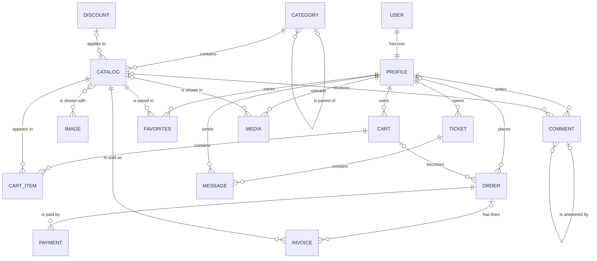
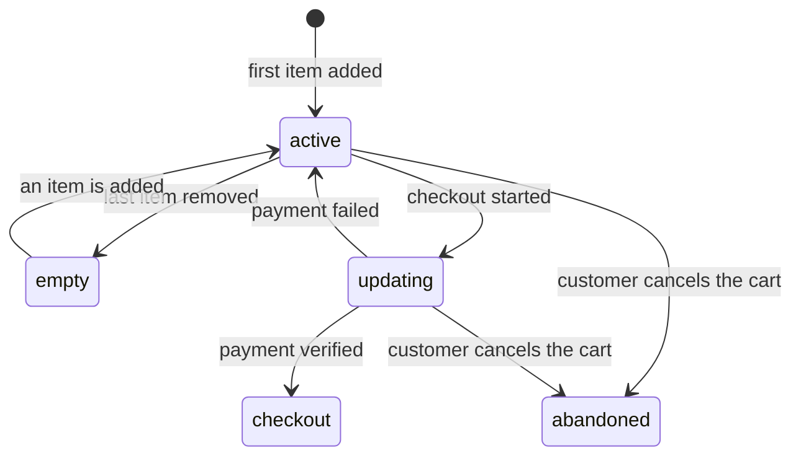
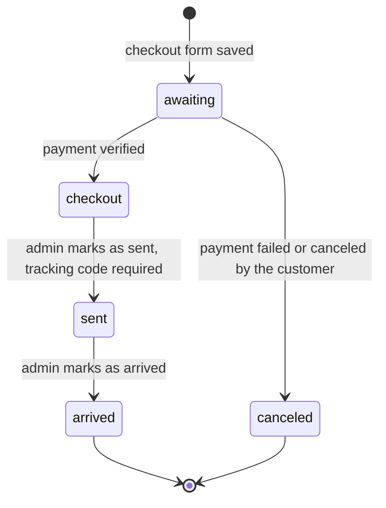
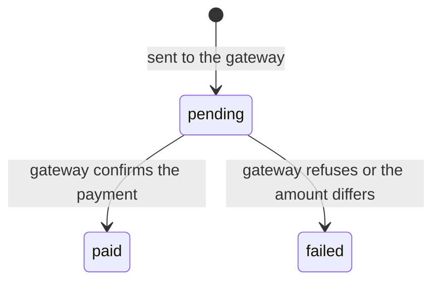
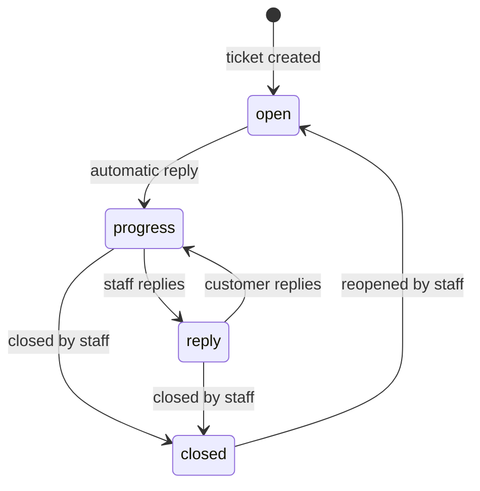
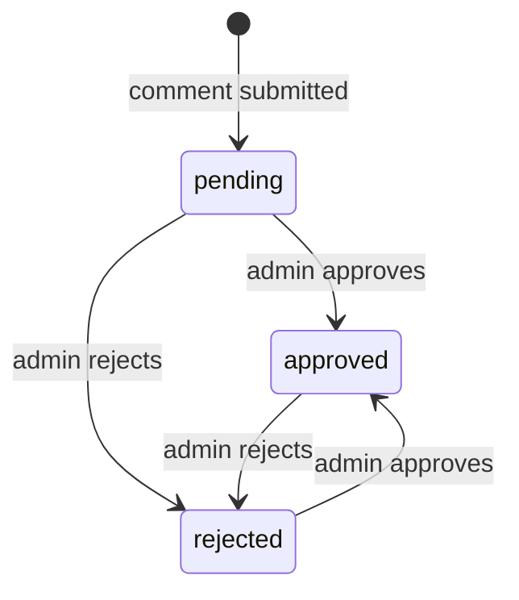
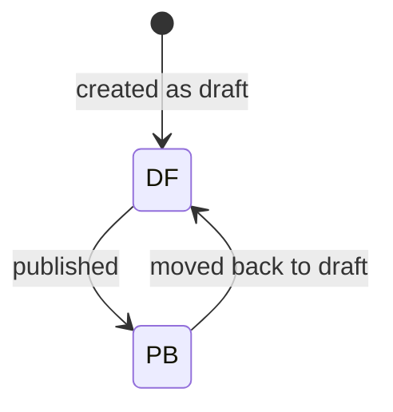

# Data model

## Relationships

Almost everything a customer does hangs off the `Profile`, and almost everything a customer sees hangs off the `Catalog`. A cart can have several orders over time, for example after a payment that failed.

## Models at a glance

| Model | App | Purpose | History | Notes |
|---|---|---|---|---|
| `User` | accounts | Login identity | Yes | Phone and username are unique; password and last login are never copied into history |
| `Profile` | accounts | Name, address, postal code, picture | Yes | Created automatically for every user |
| `Catalog` | products | A product | Yes | Two managers: `objects` (all) and `published`; `discount` is the price after the discount |
| `Category` | products | Nested category tree | Yes | The slug is generated from the title |
| `Discount` | products | A percentage applied to many products | Yes | Saving a discount re-saves its products |
| `Comment` | products | Comments and replies | Yes | Moderated: `pending`, `approved`, `rejected` |
| `Image` | products | A product picture | Yes | Shared with products through a many-to-many field |
| `Cart` | carts | A shopping cart | Yes | At most one `active` cart per profile (database constraint) |
| `CartItem` | carts | One product line in a cart | No | Stock is validated on every save |
| `Order` | orders | A placed order | Yes | `PAID_STATUSES` defines what counts as a sale |
| `Invoice` | orders | One product line of an order | Yes | `purchase_price` is the price of one unit at purchase time |
| `Payment` | orders | One attempt to pay an order at the gateway | No | A financial record, shown read-only in the admin |
| `Ticket` | tickets | A support request | Yes | `Ticket.objects` hides archived tickets; deleting archives |
| `Message` | tickets | One message in a ticket | Yes | The automatic reply is sent by the `system` profile |
| `Favorites` | userfav | A product saved by a user | Yes | The field `product_id` is a foreign key to `Catalog` |
| `Media` | multimedia | An uploaded video | Yes | A constraint allows highlighting only stories |

`CartItem` is not tracked because every "add to cart" would create a record; `Payment` is not tracked because each row is already a record of one gateway attempt.

## What happens when something is deleted

| Relationship | Rule | Effect |
|---|---|---|
| `Profile` → `User` | Cascade | Deleting a user deletes the profile |
| `Cart` → `Profile` | Cascade | A user's carts are deleted with the profile |
| `CartItem` → `Cart`, `Product` | Cascade | Items disappear with their cart or product |
| `Order` → `Profile` | Set null | The order stays, without an owner |
| `Order` → `Cart` | Set null | The order stays when its cart is deleted |
| `Invoice` → `Order` | Set null | Invoice lines stay |
| `Invoice` → `Product` | **Protect** | A product that was ever sold cannot be deleted |
| `Payment` → `Order` | **Protect** | An order with payments cannot be deleted |
| `Catalog` → `Category` | **Protect** | A category with products cannot be deleted |
| `Catalog` → `Discount` | Set null | Deleting a campaign unlinks its products |
| `Category` → parent | Cascade | Deleting a category deletes its children |
| `Comment` → user, product, parent | Cascade | Comments disappear with their author, product or parent |
| `Ticket` → `Profile` | Cascade | A user's tickets go with the profile |
| `Message` → ticket, sender | Cascade | Messages go with their ticket or sender |
| `Favorites` → profile, product | Cascade | Favorites go with the user or the product |
| `Media` → profile, product | Cascade | Videos go with their uploader or product |

The pattern is deliberate: records that involve money (orders, invoices, payments, sold products) are kept, while content and engagement (comments, favorites, tickets, media) follow their owner.

## Status lifecycles

### Cart

Only one cart per profile can be `active`. A cart in `updating` is waiting for its order to be paid and is not changed in the meantime.

### Order

`checkout`, `sent` and `arrived` all count as paid (`Order.PAID_STATUSES`). After a canceled order the cart is active again, so the customer can check out again with a new order.

### Payment

A payment stays `pending` if the gateway cannot be reached during verification, and can be verified again later.

### Ticket

A closed ticket is also archived. Reopening clears the archive flag.

### Comment

Only approved comments are shown on product pages.

### Product

`DF` is draft and `PB` is published. Public pages use `Catalog.published`, so a draft is never visible to customers.

## Constraints and rules in the database

- `Cart`: one `active` cart per profile.
- `Media`: `is_highlighted` requires `is_story` (`story_required_for_highlight`).
- `Order.tracking_code`, `Payment.track_id`, `Catalog.title`, `Catalog.slug`, `Category.slug`, `User.phone` and `User.username` are unique.
- `Discount.percent` is limited to 1–100.

## Things worth knowing

- `Catalog.category` uses the reverse name `category`, so a category reaches its products through `category.category`.
- `Favorites.product_id` is a foreign key (the database column is `product_id_id`).
- `Catalog.discount` holds the discounted *price*; the saved amount is `price - discount`.
- On PostgreSQL the order of groups and rows in a product's specifications is not preserved, because JSON is stored without key order.