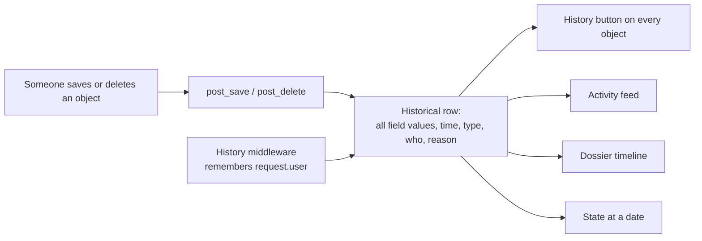

# Audit trail

Every important change is stored, so the owner can answer "who changed this, when, and what was it before?" and "how did the shop look last month?".

## How it works

The project uses `django-simple-history`. Each tracked model has a mirror table that receives a full copy of the object on every create, change and delete. `HistoryRequestMiddleware` records who made the change, and code can attach a human-readable reason with `instance._change_reason = "..."` before `save()`.

## What is tracked

| Tracked | Not tracked |
|---|---|
| `User`, `Profile`, `Catalog`, `Category`, `Discount`, `Image`, `Comment`, `Cart`, `Order`, `Invoice`, `Ticket`, `Message`, `Favorites`, `Media` | `CartItem` (every "add to cart" would create a row) and `Payment` (each row already records one gateway attempt) |

On `User`, `password` and `last_login` are excluded: password hashes are never copied, and logins do not create history rows.

## Where to look

| Need | Tool |
|---|---|
| The versions of one object | The **History** button on its page |
| What happened across the shop | [Activity feed](admin-panel.md#activity-feed) |
| Everything about one customer | The dossier's history tab |
| How a section looked on a day | [State at a date](admin-panel.md#state-at-a-date) |

## Reasons and authors

- Admin actions and the dossier buttons save a reason such as "banned: spam". It is stored in a 100-character column and the code truncates it.
- Changes made by customers are attributed to them, and changes made outside a request (signals, shell) have no author and show as "system".
- Automatic changes carry their own reason, for example the story flag set by the video check, or the stock reduction after a payment.

## Rules to follow when writing code

- Change objects with `save()`, not with `queryset.update()` or `queryset.delete()`. Those bypass the history. All admin actions follow this rule.
- To make a new model appear in the reports, add `history = HistoricalRecords()` to it and list it in `ACTIVITY_SECTIONS` (`core/reports.py`).

## Limitations

- History starts when it is installed. `python manage.py populate_history --auto` creates a first version of the existing objects, dated that day, so earlier days are empty.
- Each save stores a full row, so tables grow with activity.
- Raw SQL and bulk operations are not recorded.

## Tests

The suite checks that creates, changes and deletes are recorded, that admin actions store their author and reason, that secret fields are never copied, and that the activity feed and the state-at-a-date report rebuild the past correctly. See [testing](testing.md).