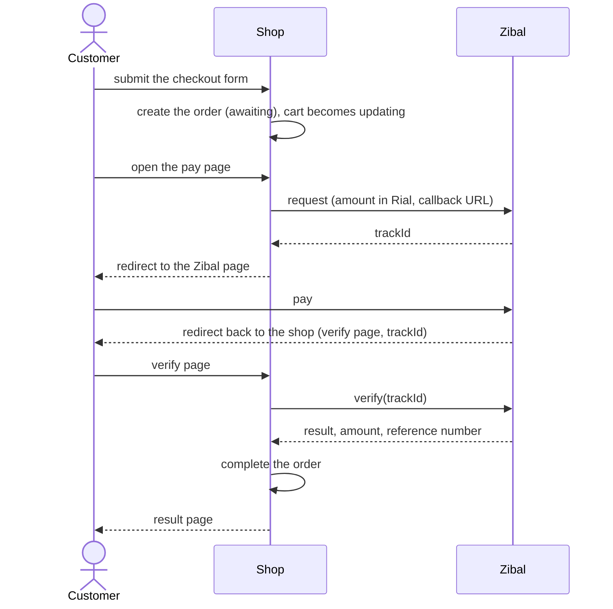

# Payments

Online payment goes through [Zibal](https://zibal.ir). The integration is built so that money is never trusted to the browser: every payment is checked again with the gateway, and repeating a step never creates a second invoice. It is sandbox-ready.

## The flow

## Moving parts

| Piece | Where | Role |
|---|---|---|
| `ZibalGateway`, `GatewayError` | `orders/zibal.py` | Talks to Zibal: `request`, `verify`, the redirect URL |
| `start_payment`, `verify_payment`, `fulfill_order`, `stock_shortages` | `orders/payments.py` | The workflow |
| `PaymentStartView` (`pay`) | `orders/views.py` | Starts a payment for the buyer's unpaid order |
| `PaymentVerifyView` (`verify`) | `orders/views.py` | The page Zibal sends the customer back to |
| `PaymentResultView` (`result`) | `orders/views.py` | Shows the outcome to the buyer |
| `Payment` | `orders/models.py` | One record per attempt |

## What happens at each step

**Start** (`pay/`): the order must belong to the user and still be `awaiting`, and the stock must still cover the cart. A `Payment` is created, the request is sent to Zibal and the customer is redirected to the `trackId` page.

**Verify** (`verify/`): the customer comes back with a `trackId`. Only that value is read from the request. The shop asks Zibal for the real outcome and accepts the payment only if the result is `100` (verified) or `201` (already verified) **and** the returned amount equals the amount that was requested.

**Complete**, inside one database transaction:

1. The payment becomes `paid`, with the reference number, the masked card and the time.
2. One `Invoice` line is created per cart item, with the price of one unit.
3. Stock is reduced, saved with a history reason ("sale of order #N").
4. The order becomes `checkout` and the cart becomes `checkout`.

## Safety properties

- **Server-side verification.** The `success` parameter in the return URL is ignored.
- **Idempotent.** A payment that is no longer `pending` is returned unchanged, and the completion step locks the payment row. Refreshing the return page or two simultaneous callbacks produce one invoice.
- **No lock during network calls.** The call to Zibal happens outside the transaction.
- **Private.** Only the buyer can start a payment or see a result; other users get 404.
- **Timeouts.** Calls to the gateway time out after 10 seconds and raise `GatewayError`.
- **No login needed for the return page**, because the session may be lost on the way; the result page afterwards does require login.

## Units

Prices are in Toman. Zibal expects Rials, so the amount is multiplied by 10 when the request is made (`TOMAN_TO_RIAL`). The customer's phone is converted from `+989123456789` to `09123456789`.

## Statuses

| Payment status | Meaning |
|---|---|
| `pending` | Sent to the gateway, outcome not known yet |
| `paid` | Verified and the order is completed |
| `failed` | The gateway refused it or the amount did not match |

- A **failed** payment cancels the order and gives the cart back (`active`), so the customer can check out again from the cart.
- If the **gateway cannot be reached during verification**, the payment stays `pending` and the customer sees a message with a "check again" link. Verifying again later completes it.
- If **stock ran out** between checkout and payment, the sale is still recorded (the customer has paid) and an error is logged for manual handling.

## Configuration

| Setting | Purpose |
|---|---|
| `ZIBAL_MERCHANT` | Merchant code. The value `zibal` selects Zibal's sandbox |

The callback URL is built from the current request, so in production the site must be reachable on its public HTTPS address and the proxy headers must be configured (see [deployment](deployment.md)).

Going live: put the real merchant code in `ZIBAL_MERCHANT` and run one real payment end to end.

## Limitations

- Pending payments are not re-checked by a scheduled job.
- Refunds are not part of the shop.

## Tests

`PaymentTests` mocks the gateway and covers the redirect, the amount in Rials, stock refusal, ownership, a successful completion (invoice, stock, statuses), repeated callbacks, a failed payment, an amount mismatch, a gateway outage during verification, invalid callbacks and the privacy of the result page. See [testing](testing.md).